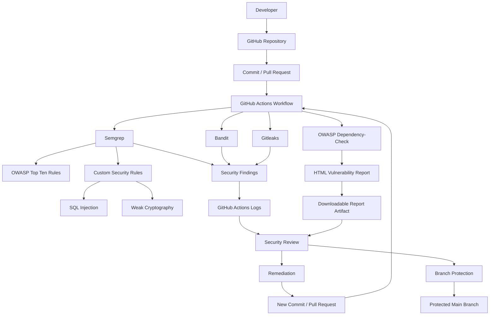

# Secure Code Review Framework
## Architecture and Configuration Document

### 1. Project Overview

The Secure Code Review Framework automates source-code security analysis and dependency vulnerability detection using open-source security tools integrated with GitHub Actions.

### 2. System Architecture

### 3. Architecture Components

| Component | Responsibility |
|---|---|
| GitHub Repository | Source code management |
| GitHub Actions | Automated workflow execution |
| Semgrep | Static code analysis and custom rules |
| Bandit | Python security analysis |
| Gitleaks | Secret detection |
| OWASP Dependency-Check | Third-party dependency vulnerability scanning |
| GitHub Actions Logs | Scanner findings and execution results |
| Report Artifact | Downloadable HTML dependency report |
| Branch Protection | Enforces required security checks before merging |

### 4. Execution Workflow

1. Developer submits code through a GitHub commit or Pull Request.
2. GitHub Actions automatically starts the security workflow.
3. Independent security scanning jobs execute.
4. Semgrep checks OWASP and custom security rules.
5. Bandit examines Python source code.
6. Gitleaks checks for exposed secrets.
7. OWASP Dependency-Check examines third-party dependencies.
8. Scan findings are made available through workflow logs and downloadable reports.
9. Developers review and remediate identified vulnerabilities.
10. Required successful checks allow eligible changes to proceed through the protected branch process.

### 5. Security and Access Control

The repository uses GitHub authentication, repository permissions and branch protection.

The Protect Main Branch ruleset requires Pull Requests and successful Bandit, Semgrep and Gitleaks checks. Force pushes are blocked.

### 6. Scalability and Extensibility

The framework can be extended by:

- Adding Semgrep rules for additional programming languages.
- Integrating additional static analysis tools.
- Introducing centralized security dashboards.
- Adding application-level authentication and RBAC.
- Integrating additional version control platforms.
- Introducing historical vulnerability tracking.

### 7. Implementation Scope

The architecture diagram represents the current GitHub-based scanning implementation. Advanced dashboards, standalone application-level RBAC and additional integrations are future enhancements rather than completed features.
